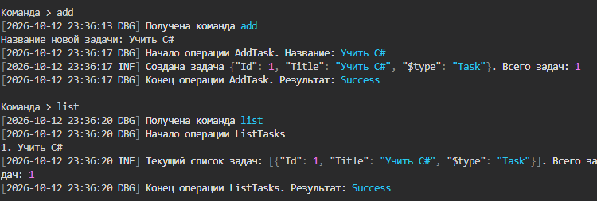
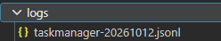
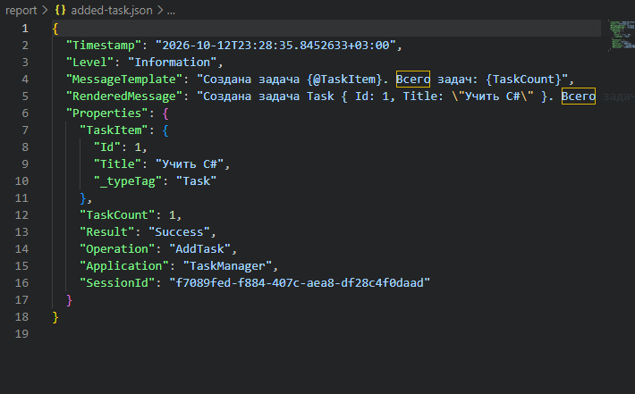
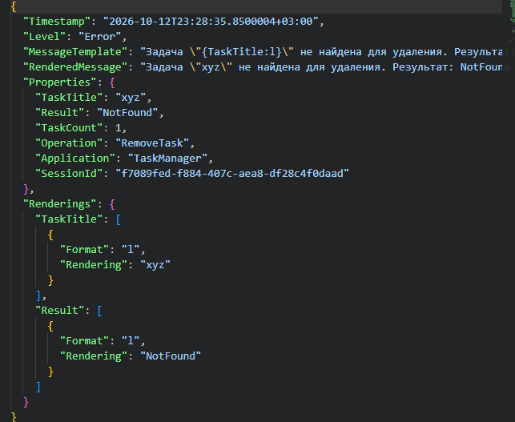

# КТ-3 - Структурированные логи

Студент - Денисенко Даниил Евгеньевич  
Группа - 4п4.23 NET  
Дисциплина - Логирование и трассировка C#  

### Задания

Наш TaskManager уже умеет:

Добавлять задачи,Удалять задачи,Выводить список задач,Логировать базовые действия (через Trace или Serilog/другой инструмент).

Используем знания и примеры предыдущих работ и продолжаем развитие проекта TaskManager, добавляем более детальные логи.

Текущие задачи:

1. Заменить или дополнить текущую реализацию логирования, чтобы записи хранились в структурированном виде.

2. Оформить краткий отчет по проделанной работы (скриншоты, ссылка на github).

### Задание 1

Продолжил TaskManager из КТ-2 в отдельном проекте на .NET 10
Добавление, удаление и вывод списка задач работают через прежние команды
В консоли оставил текстовые сообщения, в файл добавил запись JSON через JsonFormatter
Каждая строка файла содержит отдельную JSON-запись

Задача «Учить C#» добавлена и отображается в списке, в консоли видны сообщения Debug и Information

Логи сохраняются в папке logs в файлах вида taskmanager-ГГГГММДД.jsonl
Для каждого дня создаётся отдельный файл, при повторном запуске в тот же день сообщения дописываются

В папке logs находится файл структурированных логов с датой в названии

Запись содержит Timestamp, Level, MessageTemplate, RenderedMessage и Properties
В Properties сохраняются операция, результат, количество задач и данные задачи
Добавил ID задач и SessionId для различения задач и запусков программы
Шаблон TaskItem сохраняет объект с полями Id и Title, Tasks сохраняет список задач

В событии добавления задача представлена объектом TaskItem, количество задач сохранено числом

При удалении задачи «xyz» записаны уровень Error, операция RemoveTask и результат NotFound

### Задание 2

Документ с логами выполненного сценария: [logs.jsonl](report/logs.jsonl)

